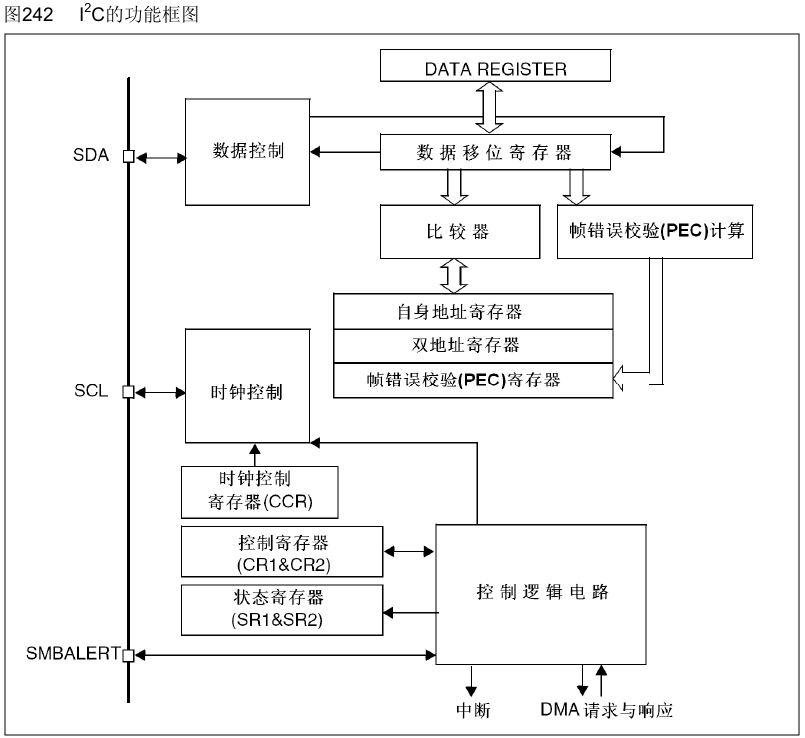
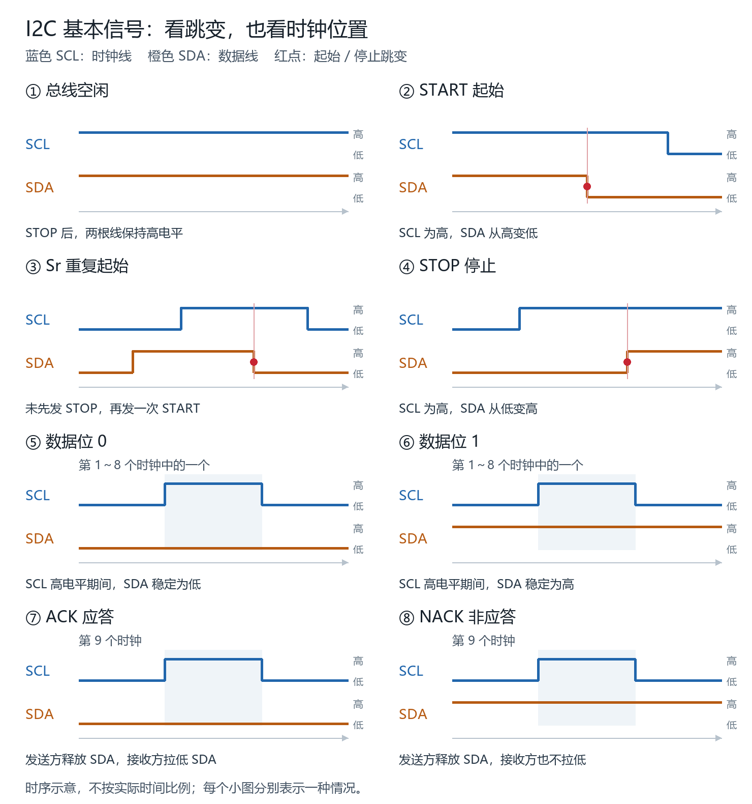
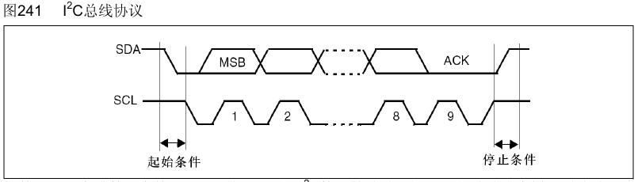
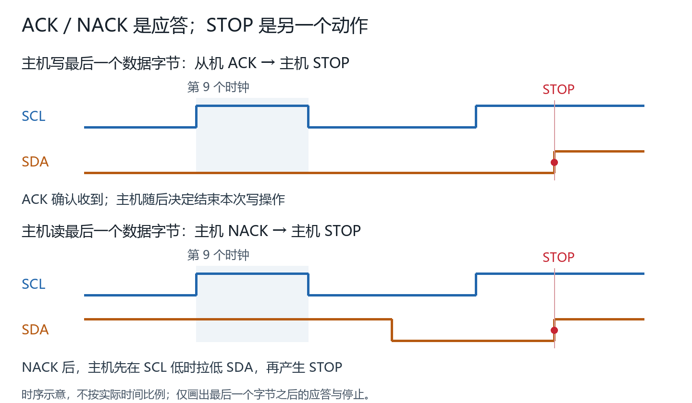

# I2C：从传感器通信到数据读取

整理日期：2026-10-13。背景为 STM32F103；本页是本轮外设小节笔记，与[每日学习记录](../../study-log/2026-10-13.md)配套。已讲解、待巩固、待学习分别标明，尚未形成完整可运行驱动。

## 1. 功能地图与系统分工

I2C 用 SDA 数据线和 SCL 时钟线，使 STM32 可以选择一颗传感器、写入配置或读取测量结果。同一总线可连接地址不同的器件。

```text
CPU：组织操作、判断状态、解释测量值
             ↕ 数据寄存器 / 控制与状态
STM32 I2C 外设：串并转换、时钟、协议信号
             ↕ SDA + SCL
传感器：响应地址、接收配置、提供测量数据
```

本例 STM32 发起通信并产生时钟，因此是主机；传感器是从机。主机可以发送，也可以接收。角色由通信职责决定，不由器件是否“更重要”决定。

相同型号不意味着地址必须相同。是否能通过地址引脚或配置修改地址，须查器件数据手册；固定地址相同的两颗器件不能仅靠同一地址字节分别选中，可考虑独立总线或 I2C 多路复用器。

## 2. 实际资料与阅读位置

[STM32F10xxx参考手册（中文）](../STM32F10xxx参考手册（中文）.pdf)第 24 章是本轮主要资料，以下均为已核对的 PDF 页码，对应页面印刷页码相同。

| 页码 | 内容 | 用来解释什么 |
| --- | --- | --- |
| 493～494 | 功能、模式、通信流与图 241 | 谁启动、谁给时钟、每字节的应答 |
| 495 | 图 242 I2C 框图 | CPU、DR、移位寄存器与线路的关系 |
| 497 | 主模式与起始条件 | START 与重复 START |
| 498 | 地址最低位与图 245 主发送器 | 同一设备的写方向与写入过程 |
| 499 | 图 246 主接收器 | 接收字节、最后一字节 NACK 与结束通信 |
| 509 | 24.6.5，DR | 数据寄存器保存发送或接收字节 |
| 510 | SR1.TIMEOUT | 硬件时钟低电平超时条件 |
| 511 | SR1.RxNE 及 BTF 相关注释 | 判断 DR 有数据，理解读后标志的例外 |

参考手册说明 STM32 外设机制；真实传感器的寄存器与单位还需要其数据手册。本轮尚未选定传感器。中文手册为旧版译文，具体 STM32F1 接收尾部代码需进一步核对对应英文资料与芯片勘误，不能直接把教学序列当作完整寄存器操作时序。



## 3. 开漏、上拉与基本标志

SDA 的高电平来自上拉。器件可以主动拉低线路，或释放线路；只要还有器件拉低，线路就保持低电平。正常数据位在 SCL 低时改变、在 SCL 高时稳定。

| 情况 | SCL 条件 | SDA 条件 | 意义或发出方 |
| --- | --- | --- | --- |
| 空闲 | 高 | 高 | 总线空闲状态 |
| START，S | 高 | 高 → 低 | 主机开始通信 |
| 重复 START，Sr | 高 | 高 → 低 | 未先 STOP，再进入寻址阶段 |
| STOP，P | 高 | 低 → 高 | 主机结束通信 |
| 数据 0 | 有效高电平期间 | 稳定低 | 当前发送方发送 0 |
| 数据 1 | 有效高电平期间 | 稳定高 | 当前发送方释放 SDA，发送 1 |
| ACK，A | 第九个时钟 | 低 | 当前接收方拉低，确认本字节 |
| NACK，NA | 第九个时钟 | 高 | 当前接收方释放 SDA，发送方也释放 |



Sr 的电气形态与 START 相同，区别在于它出现在尚未结束的通信中。它本身不携带读写方向。

## 4. 应答与结束是不同的操作

一个字节先发送 8 个数据位，高位在前；第九个时钟用于应答，由当前接收方决定 ACK 或 NACK，时钟仍由主机提供。发送方在应答位释放 SDA。

| 当前发送内容 | 接收方 | 第九位由谁决定 |
| --- | --- | --- |
| STM32 发送设备地址 | 被寻址的传感器 | 传感器 |
| STM32 写寄存器地址或配置 | 传感器 | 传感器 |
| 传感器向 STM32 发测量数据 | STM32 | STM32 |

在主机读取数据的场景中，中间字节 ACK 表示允许继续发下一字节，最后字节 NACK 表示本字节接收结束、不再要下一字节。不能把这一读场景解释推广成“任何 ACK 后都必须继续通信”。

```text
主机写最后一字节 → 从机 ACK → 主机 STOP
主机读最后一字节 → 主机 NACK → 主机 STOP 或 Sr
```



图 241 的 ACK 后出现 STOP 是有效的示意。它并不要求该字节一定是主机读取的最后一字节。



NACK 是第九个时钟的高电平；STOP 必须有 SCL 高时 SDA 从低到高的变化。如果 SDA 在 NACK 时已经为高，主机需先在 SCL 低期间使 SDA 为低，再形成 STOP。第九位不是第九个数据位，也不是温度寄存器的写入指令。

## 5. 三类字节与方向选择

以下使用教学模型：设备 7 位地址 `0x48`，温度寄存器 `0x00`，配置寄存器 `0x01`，配置值 `0x02`。这些数值未对应已核对的真实器件。

7 位地址模式下，线上的首字节由设备地址左移一位，再加最低位 R/W 构成：

```text
设备地址 0x48 = 1001000
写方向：1001000 0 = 0x90，STM32 → 传感器
读方向：1001000 1 = 0x91，传感器 → STM32
```

读地址字节 `0x91` 仍由 STM32 发送；其后的数据阶段才由传感器发送。这是同一设备的两种操作。

| 字节类别 | 教学例子 | 回答的问题 |
| --- | --- | --- |
| 设备地址与方向 | 0x90、0x91 | 找哪颗器件，接下来谁发送数据？ |
| 寄存器地址 | 0x00、0x01 | 访问这颗器件内部哪个位置？ |
| 数据或配置值 | 0x02、高低字节 | 写什么内容，或读到了什么内容？ |

`0x00` 也是有效的发送字节，不表示“跳过发送”。使用 HAL/SPL 等接口时，还须核对函数要求传入 7 位地址还是移位后的地址，不能只凭线上字节机械填参；本轮未选择具体驱动库。

## 6. 写配置与读寄存器的完整序列

### 写配置：已讲解

```text
S → 0x90 → A → 0x01 → A → 0x02 → A → P
    选设备并写    选配置寄存器   写配置值
```

模型假设写方向中第一个数据字节选择寄存器，第二个数据字节写入配置。具体器件是否遵循该规则、是否自动递增地址，要看其数据手册。

### 读两字节：已讲解

```text
S → 0x90 → A → 0x00 → A → Sr → 0x91 → A → 高字节 → A → 低字节 → NA → P
    写方向       选择温度位置       读方向       STM32接收并应答
```

| 阶段 | 数据发送方 | 目的 |
| --- | --- | --- |
| 0x90 | STM32 | 选中设备，指定写方向 |
| 0x00 | STM32 | 写入寄存器选择信息 |
| Sr 后的 0x91 | STM32 | 重新寻址同一设备，指定读方向 |
| 两个测量字节 | 传感器 | 输出被选寄存器的数据 |

Sr 前已经是写操作，只是写入的是寄存器选择信息；Sr 后才切换为读取数据。Sr 让总线重新进入寻址阶段，方向由随后的地址字节最低位决定。它也可以用于继续写或寻址其他设备，不仅用于改成读取。

模型假设传感器在 Sr 后保留寄存器指针。重新寻址不等于重置内部指针；是否允许用 STOP 再 START 替代 Sr，同样由器件定义。同一写阶段连续写配置通常不需要 Sr。

## 7. 从线路字节到温度变量：已讲解基础

```text
传感器数据 → SDA → I2C 移位寄存器 → DR，RXNE=1
                                               ↓ CPU 读取
                                       high、low → raw → temperature
```

硬件收到字节后，普通变量不会因为 RXNE 置位而自动更新。在本轮不使用 DMA 的条件下，CPU 需要检查状态并读取 DR。不能默认刚读完第一个字节，第二个字节已经到达。

本轮按及时取走每字节的简化流程讲解。手册 PDF 第 511 页指出：BTF 置位时，读 DR 后 DR 仍可能有数据，RXNE 不一定清零。完整缓冲与接收尾部时序尚待学习。

假设器件先发送高字节，再发送低字节，且数据是无符号 16 位：

```c
uint16_t raw = ((uint16_t)high << 8) | low;
// high=0x01、low=0x2C → raw=0x012C=300
```

假设零偏移、分辨率为 0.1℃/单位，CPU 可用 `raw * 0.1f` 得到 30℃。真实器件可能采用有符号值、其他分辨率或特殊位布局，换算须以数据手册为准。普通求和的错误在于没有保留高低字节位置，而不是“加法结果一定只有 8 位”。

## 8. 轮询、超时与状态接口：已讲解基础

一直轮询 RXNE 会占用当前程序流程。若始终没有数据，后续主循环任务无法继续；已启动的硬件 PWM 和允许执行的中断不因该等待自动停止。

软件超时是在程序中设定最大等待期限。SR1.TIMEOUT 对应 SMBus 的 SCL 低电平与累积时钟扩展条件，不能当作任何软件等待到期都会置位的通用标志。

接口应区分“这次读取是否成功”和“温度数值”。下面仅是教学接口，没有函数实现；约定只有完整读取成功才更新输出变量。

```c
typedef enum {
    TEMP_OK,
    TEMP_TIMEOUT,
    TEMP_ERROR
} TempStatus;

TempStatus ReadTemperature(float *temperature);

// 放在调用函数内部：
// float temperature = 30.0f;  // 上一次成功结果
// TempStatus status = ReadTemperature(&temperature);
// if (status == TEMP_OK) {
//     使用本次结果；
// } else {
//     温度仍可能是旧值，本次结果未成功更新；
// }
```

`&temperature` 提供变量地址，让函数能够通过指针写回数据。是否在失败时保持旧值由接口约定和实现保证，不能假设所有现成驱动都如此。

| 返回状态 | 温度变量 | 判断 |
| --- | --- | --- |
| TEMP_OK | 0.0℃ | 成功读到 0℃ |
| TEMP_OK | 30.0℃ | 成功读到 30℃ |
| TEMP_TIMEOUT | 保留旧值 30.0℃ | 本次读取超时，不能当作新测量 |

先检查 `status`，确认成功后再使用数据作为本次结果。已有串口 `UART1_ReceiveByte(&byte)` 也采用返回状态、指针输出数据的形式；该串口函数仍是无限阻塞，未实现超时，且接收错误时可能仍输出字节，具体契约与本教学温度接口不同。

## 9. 当前学习断点：已引入，尚未完成问答

加入超时避免永久卡住，但等待期间仍可能占住当前流程。假设下面的函数内部最多轮询等待 20 ms：

```c
status = ReadTemperature(&temperature);
ScanButtons();
```

待回答：如果传感器一直不响应，按键扫描只放在函数后面，没有放进中断，在这 20 ms 的等待期间能否执行 `ScanButtons()`？

这个问题用于引出非阻塞处理：等待数据期间返回主循环，允许执行其他任务，下一轮再根据状态继续。尚未展开状态机或编写实现。

## 10. 未完成的学习路线

| 顺序 | 主题 | 当前状态与下一步 |
| --- | --- | --- |
| 1 | 有限超时与非阻塞 | 已引入；先完成当前场景问答 |
| 2 | 分步轮询与状态机 | 待学习：开始、等待、收集、成功或失败收尾，并安排按键任务 |
| 3 | 真实器件数据手册 | 待选型号；查地址、寄存器、指针、字节序、单位与符号 |
| 4 | 最小读取函数 | 待实现：完整结果才提交、检查返回状态、失败保留旧结果 |
| 5 | F103 硬件初始化 | 待学习：按实际时钟、引脚、库和上拉条件配置 I2C |
| 6 | 接收尾部与事件 | 待学习：ADDR 清除、ACK/POS/BTF/STOP，区分 1、2、多字节接收 |
| 7 | 错误与总线恢复 | 待学习：无应答、BERR、ARLO、软件超时和线路被拉低时的处理 |
| 8 | 中断、DMA | 按需求再学；它们不会替代全部协议组织与结束处理 |
| 9 | 工程与实物验证 | 未进行：完整编译链接、烧录、逻辑分析仪与实际测量 |

## 11. 本轮纠正重点与完成边界

- 主机角色由通信职责判断；接收数据时主机仍是主机。
- ACK/NACK 的发出方随接收方变化；一个字节不需要先 ACK 再 NACK。
- ACK、NACK 与 STOP 各自承担不同作用；主机写完可在 ACK 后 STOP。
- Sr 前的 0x90 已有写方向；0x00 是寄存器选择信息；Sr 后方向由 0x91 决定。
- DR 中有数据不等于 CPU 已更新变量；拼接与温度换算由软件完成。
- 温度值不能证明本次读取成功；先检查返回状态，成功读到 0℃也是有效结果。

完成的是基础原理、给定场景问答、手册图示和接口解释。尚未独立实现完整驱动、核对真实传感器、编译或上板；不能据此认定已熟练掌握所有接收时序和错误恢复。
